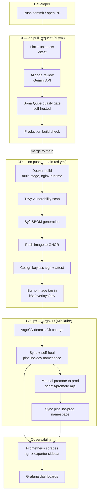

# Architecture

## Overview

This project implements an **AI-Augmented CI/CD Pipeline**: a unified DevOps
ecosystem that combines intelligent code analysis, automated testing,
software-supply-chain security, GitOps-based deployment, and observability —
built entirely from open-source and zero-cost tools.

The demo application is a **Pipeline Dashboard**, a React + Vite single-page
app that itself visualizes the pipeline's build history, security scan
results, and per-environment deployment status.

## End-to-end flow

## Why each tool

| Concern | Tool | Why |
|---|---|---|
| Version control / CI trigger | GitHub + GitHub Actions | Free for this repo size, native OIDC support for keyless signing |
| AI code review | Google Gemini (free tier) | Genuinely zero-cost API, no self-hosted GPU needed |
| Static code quality | SonarQube Community (self-hosted) | Open-source, no SonarCloud account required |
| Containerization | Docker, multi-stage build | Small final image (nginx-alpine runtime, no Node.js in production) |
| Container registry | GHCR | Free, integrated with `GITHUB_TOKEN`, no separate account |
| Vulnerability scanning | Trivy | Open-source, scans OS packages + app dependencies in one pass |
| SBOM generation | Syft | Industry-standard SPDX output, supply-chain transparency |
| Image signing | Cosign (keyless via Sigstore) | No key management — trust anchored to GitHub's OIDC issuer |
| GitOps delivery | ArgoCD | Declarative, self-healing, drift-correcting deployment |
| Orchestration | Kubernetes (Minikube) | Free local cluster, same manifests portable to any real cluster |
| Observability | Prometheus + Grafana | De facto open-source standard for Kubernetes metrics |

## Environments

- **dev** (`k8s/overlays/dev`): auto-synced by ArgoCD on every merge to `main`. This is where `cd.yml` lands new image tags automatically.
- **prod** (`k8s/overlays/prod`): sync is **manual** — `scripts/promote.mjs` copies the verified dev tag forward, then `argocd app sync pipeline-dashboard-prod` (or a UI click) ships it. Production is never an automatic side effect of a merge.

## Closing the loop

`cd.yml` can optionally regenerate `app/src/data/pipeline-status.json` from
the real Trivy/Syft/Cosign output of each run and commit it back to the
repo. That means the dashboard the pipeline deploys is, over time, an
accurate reflection of the pipeline's own state — a small but genuine
closed-loop touch that ties the "unified DevOps ecosystem" framing back to
something you can actually look at.
