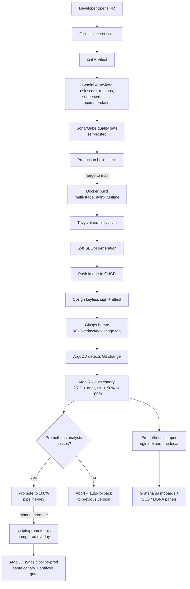

# Architecture

## Overview

This project implements an **AI-Augmented, Intelligent DevSecOps & GitOps
Platform**: code moves from pull request to production through AI-assisted
risk analysis, automated testing, secret and vulnerability scanning,
supply-chain-signed container images, progressive canary delivery with
automatic rollback, and real-time observability against measurable
reliability objectives — built entirely from open-source and zero-cost
tools.

The demo application is a **Pipeline Dashboard**, a React + Vite SaaS-style
app that visualizes the pipeline's own build history, AI risk scores,
security posture, canary rollout state, and DORA/SLO metrics.

## End-to-end flow



## Why each tool

| Concern | Tool | Why |
|---|---|---|
| Version control / CI trigger | GitHub + GitHub Actions | Free for this repo size, native OIDC support for keyless signing |
| Secret scanning | Gitleaks | Open-source, catches leaked credentials before they ever reach a scan |
| AI code review + risk scoring | Google Gemini (free tier) | Genuinely zero-cost API; structured JSON output drives a real go/no-go signal, not just prose |
| Static code quality | SonarQube Community (self-hosted) | Open-source, no SonarCloud account required |
| Containerization | Docker, multi-stage build | Small final image (nginx-alpine runtime, no Node.js in production) |
| Container registry | GHCR | Free, integrated with `GITHUB_TOKEN`, no separate account |
| Vulnerability scanning | Trivy | Open-source, scans OS packages + app dependencies in one pass |
| SBOM generation | Syft | Industry-standard SPDX output, supply-chain transparency |
| Image signing | Cosign (keyless via Sigstore) | No key management — trust anchored to GitHub's OIDC issuer |
| Progressive delivery | Argo Rollouts | Canary steps + automated analysis-driven promotion/rollback |
| GitOps delivery | ArgoCD | Declarative, self-healing, drift-correcting deployment |
| Orchestration | Kubernetes (Minikube) | Free local cluster, same manifests portable to any real cluster |
| Observability | Prometheus + Grafana | De facto open-source standard for Kubernetes metrics |

## AI Pipeline Intelligence

`scripts/ai-review.mjs` doesn't just comment on style — it asks Gemini for a
structured JSON response (summary, findings, a 0-100 risk score, risk level,
reasons, recommended tests, and a recommendation of `auto_deploy` /
`manual_approval` / `block`) and posts it as a formatted PR comment. The
`/ai-insights` page in the dashboard aggregates this over time: failure
prediction distribution, top failure causes, and the average risk score
across recent PRs.

The risk score today is a prompt-driven heuristic (Gemini reasoning over
diff size, which files changed, and visible test coverage signals) rather
than a trained model. The natural next step, once enough labeled
deploy-outcome data exists, is to replace the LLM call with a lightweight
classifier (logistic regression or a small gradient-boosted tree) trained
on: change size, files touched, test-failure history, security findings,
code-quality signals, and deployment history — the LLM path is a strong
cold-start baseline that needs zero training data.

## Progressive delivery and self-healing

`k8s/base/rollout.yaml` deploys the app as an Argo Rollouts `Rollout`
(canary strategy) instead of a plain `Deployment`:

```
25% traffic → pause → Prometheus analysis → 50% → pause → 100%
```

`k8s/base/analysis-template.yaml` gates the "analysis" step on a live
Prometheus query. **Honesty check**: the demo wires this to the
nginx-exporter's `nginx_up` reachability metric, because the stock nginx
`stub_status` module (what `nginx-prometheus-exporter` reads) doesn't expose
per-status-code request counts — a true HTTP error-rate query isn't
available from this exporter. If the query fails its `successCondition`
across `failureLimit` checks, Argo Rollouts aborts the rollout and reverts
traffic to the previous stable version automatically — no human in the
loop. The `/ai-insights` page's "Simulate deployment failure" panel narrates
exactly this decision sequence for anyone who can't watch the live cluster.

For a production deployment with real HTTP traffic, swap the query for
`ingress-nginx` controller metrics (which do carry a `status` label) or an
app-level RED-metrics exporter — both documented inline in
`analysis-template.yaml`.

## Environments

- **dev** (`k8s/overlays/dev`): ArgoCD auto-syncs on every merge to `main`, canary-gated by the same AnalysisTemplate.
- **prod** (`k8s/overlays/prod`): promotion is **manual** — `scripts/promote.mjs` copies the verified dev tag forward, then `argocd app sync pipeline-dashboard-prod` (or a UI click) starts prod's own canary rollout. Production is never an automatic side effect of a merge.

## Reliability metrics

`/security` and `/deployments` surface two families of numbers that are easy
to talk about in an academic write-up but often missing from student
projects:

- **SLOs** (`slo` in `pipeline-status.json`): availability, HTTP success
  rate, P95 latency, deployment success rate, and remaining error budget —
  each with an explicit target, not just a raw number.
- **DORA metrics** (`dora`): deployment frequency, lead time for changes,
  change failure rate, and MTTR — the four metrics the DevOps Research and
  Assessment program found correlate with organizational performance.

## What's live vs. designed-only

Given this runs on a single laptop's Docker Desktop instance (~3.7GB
allocated), some items from the fuller DevSecOps/GitOps vision are
deliberately **designed and documented, not deployed**, so the components
that matter most (Rollouts canary + Prometheus-gated rollback, ArgoCD,
Trivy/Syft/Cosign) have room to actually run:

- **Centralized logging (Loki)**: not installed locally to conserve cluster
  memory; `docs/RUNBOOK.md` notes the Helm chart and wiring.
- **Admission-time signature verification** (only run Cosign-signed images):
  documented in `docs/SECURITY.md` as a policy (e.g. via Kyverno or OPA
  Gatekeeper), not installed here.
- **Chaos/failure injection**: the `/ai-insights` "Simulate deployment
  failure" panel narrates the real decision logic the Rollout+Analysis
  step performs, but doesn't reach into the live cluster to break a pod —
  see the component's doc comment for why.
